# PetTrading
宠物用品推荐小程序 亮点：协同过滤商品推荐、ECharts运营看板、宠物商城业务流程、优惠券与库存联动、 商品资料灵活维护；

所有源码均本人开发，项目是前后端分离的，所有的项目都具备了完整的业务逻辑，不仅仅局限于基础的增删改查（CRUD）操作，系统亮点众多。

本文注重于计算机毕业设计选题指导，列出题目均有源码， 大家可以去【公众号】(毕业终点站)获取或者加我【qq】(2112698948)提意见(别忘记Star哟)。备注：git

声明：仅用于学习使用，请勿用于任何商业行为！

1.系统非商用，非开源，非无偿。

2.由本人开发，如需源码，请联系以下方式，qq:2112698948。

3.项目有很多，并未全部上传，如果未找到想要的，可直接咨询。

# 爪爪优选 · 宠物用品推荐小程序

一个面向宠物主人的用品商城小程序：首页按购买行为做协同过滤推荐，商品覆盖主粮、零食、用品和活体，下单时校验库存与优惠券，后台用 ECharts 看销量和分类分布。

## 一、系统亮点

**协同过滤商品推荐**
按用户历史购买次数构建偏好数据，用余弦相似度找相似用户，再筛出他们买过的商品；候选不够时回退到近期商品。推荐结果落在首页「专属推荐」「为你推荐」和商品详情里。

**宠物商城全流程**
围绕宠物、主粮、湿粮和日常用品，把分类浏览、搜索、收藏、购物车、优惠券结算、订单发货、确认收货、星级评价串起来，下单到收货每一步都有对应页面。

**优惠券与库存联动**
下单时同时校验购买数量、商品库存和优惠券门槛，算出优惠后金额，扣减库存并记录优惠券使用情况，不用人工再核一遍账。

**ECharts 运营看板**
工作台给出累计已支付金额、订单总数、商品总数、低库存商品 4 项汇总，配近 7 日销量折线和商品分类占比环图，另可按 7 天 / 30 天看已支付订单的商品件数走势。

**商品资料灵活维护**
商品支持分类、图文详情、封面与多图、视频、单位、价格、库存和自定义属性，活体、食品、日用品这几类都能用同一套表单录进去。

## 二、技术选型

| 层次 | 技术 |
| --- | --- |
| 架构 | B/S、MVC、前后端分离（小程序端 + 管理后台） |
| 小程序端 | uni-app、Vue 2、Vuex、ColorUI、uni-ui、微信小程序 API |
| 管理后台 | Vue 2、Vue CLI、Webpack、Element UI、Vue Router、Vuex、Axios、ECharts |
| 后端 | Java 17、Spring Boot 3、Spring MVC、MyBatis-Plus、MySQL、JWT、Apache POI |
| 推荐算法 | 基于用户的协同过滤、余弦相似度、购买行为分析 |
| 开发环境 | IDEA、Maven、HBuilderX、微信开发者工具 |

## 三、角色与功能

| 用户端（微信小程序） | 管理员端（Web 后台） |
| --- | --- |
| 注册登录、个人资料与头像维护 | 用户信息维护与账号查询 |
| 首页轮播、分类浏览、商品搜索 | 分类管理、分类封面与排序设置 |
| 商品详情、属性查看、为你推荐 | 商品图文详情、属性、价格、库存、上下架 |
| 收藏、我的收藏、商品评价查看 | 订单查询、订单明细、物流单号填写与发货 |
| 购物车、数量调整、立即购买、订单确认 | 优惠券配置、使用门槛与有效期、领取记录 |
| 收货地址增删改、下单地址选择 | 用户反馈查看与回复、首页轮播封面管理 |
| 优惠券领取、结算时选择优惠券 | 数据看板：商品总数、订单总数、已支付金额、低库存 |
| 微信 / 支付宝 / 银行卡支付并记录订单 | 商品销量、分类销量、库存排行、订单状态、支付方式分析 |
| 我的订单、取消、确认收货、文字评价与星级 | 近 7 天 / 30 天销量趋势分析 |
| 意见反馈提交、反馈记录与后台回复查看 | — |

## 四、系统截图

### 登录入口

管理后台登录页，账号、密码、验证码三项校验，左侧是品牌展示区。用户端走微信小程序授权登录，不经过这个入口。

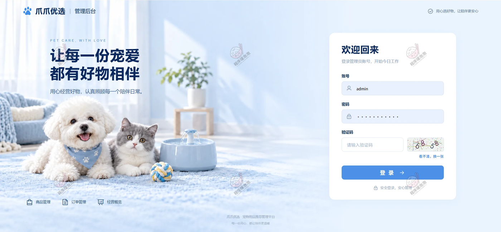

### 用户端（微信小程序）

<table>
<tr>
<td width="50%">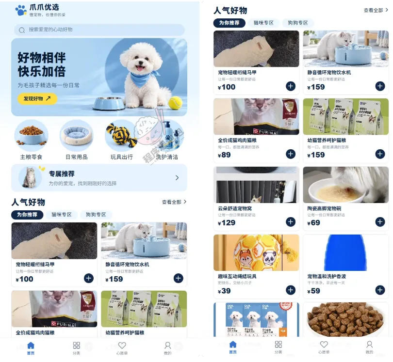 <strong>首页 · 推荐与分类</strong> 顶部搜索和轮播，四个分类入口（主粮零食 / 日常用品 / 玩具出行 / 洗护清洁），下面是「专属推荐」和「人气好物」，可切为你推荐、猫咪专区、狗狗专区。</td>
<td width="50%">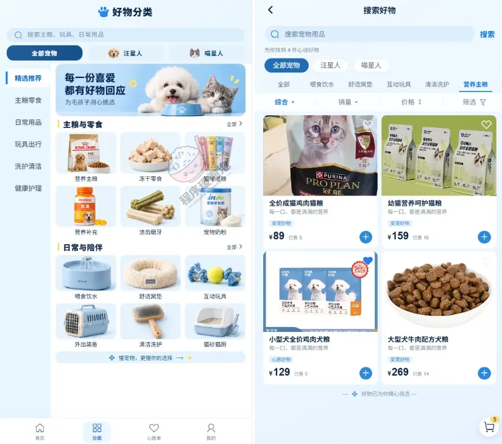 <strong>好物分类 · 搜索与筛选</strong> 左侧按主粮零食、日常用品、玩具出行、洗护清洁、健康护理分栏，右侧可切汪星人 / 喵星人，按综合、销量、价格排序再筛。</td>
</tr>
<tr>
<td width="50%">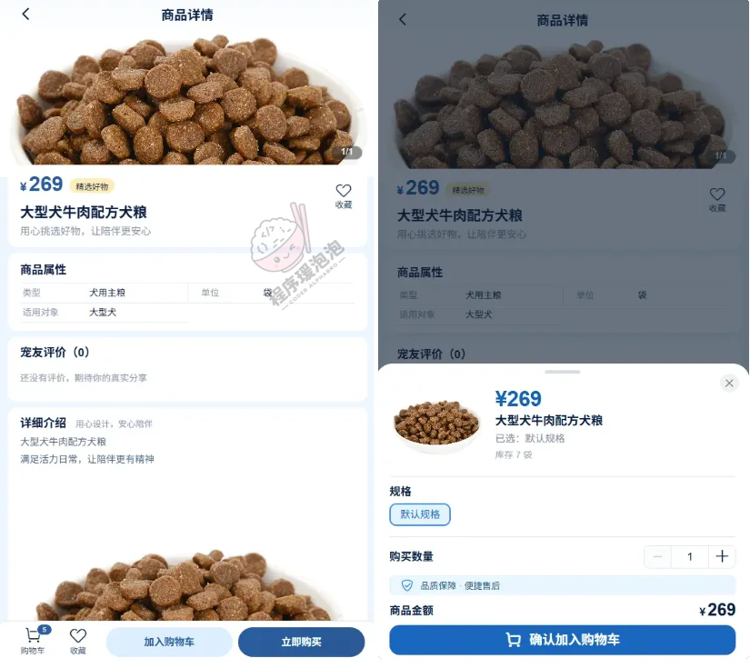 <strong>商品详情 · 属性与加购</strong> 商品属性列出类型、单位、适用对象，下面是评价和详细介绍；点加购弹出规格、数量、库存和金额确认。</td>
<td width="50%">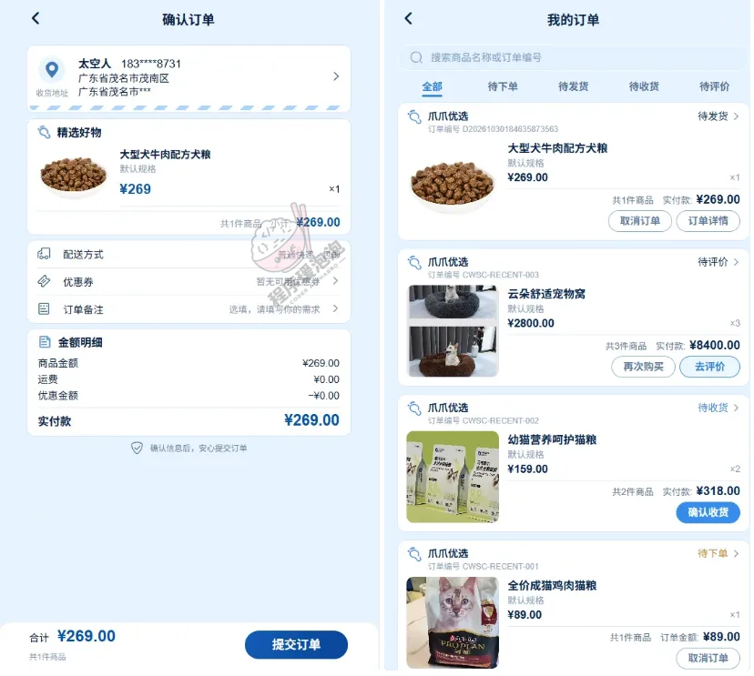 <strong>确认订单 · 结算与我的订单</strong> 左侧是收货地址、商品清单、配送方式、优惠券、订单备注和金额明细；右侧是全部、待下单、待发货、待收货、待评价各状态订单。</td>
</tr>
<tr>
<td width="50%">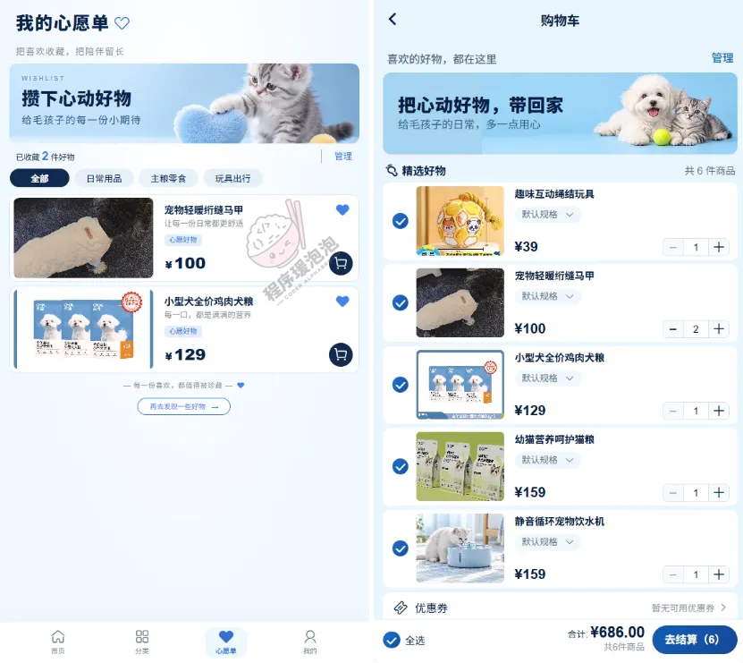 <strong>心愿单与购物车</strong> 左边收藏按品类分组；右边购物车支持勾选、增减数量，底部显示优惠券入口、合计金额和去结算件数。</td>
<td width="50%">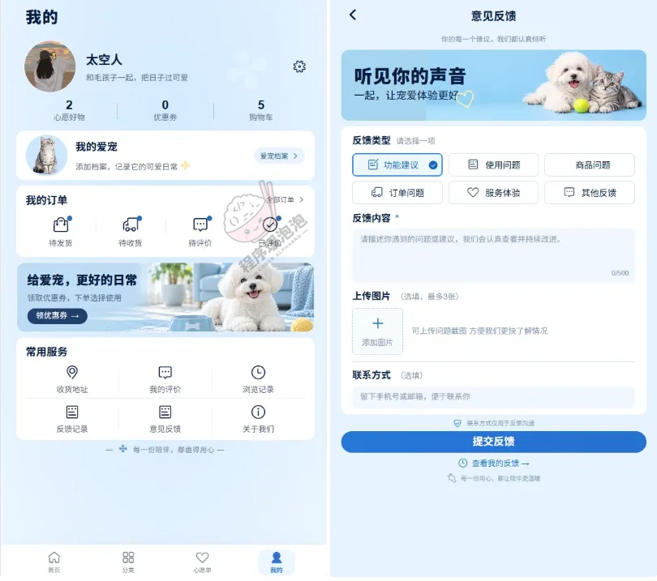 <strong>个人中心与意见反馈</strong> 顶部显示心愿好物、优惠券、购物车数量，往下是爱宠档案、订单状态和常用服务；右侧是意见反馈表单，可选类型、上传图片、留联系方式。</td>
</tr>
</table>

### 管理员端（Web 后台）

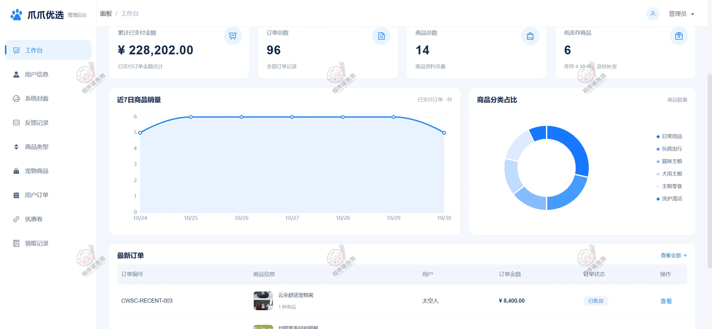

**工作台 · 运营看板**
四张指标卡分别是累计已支付金额、订单总数、商品总数和低库存商品；下方是近 7 日商品销量折线、商品分类占比环图和最新订单列表。

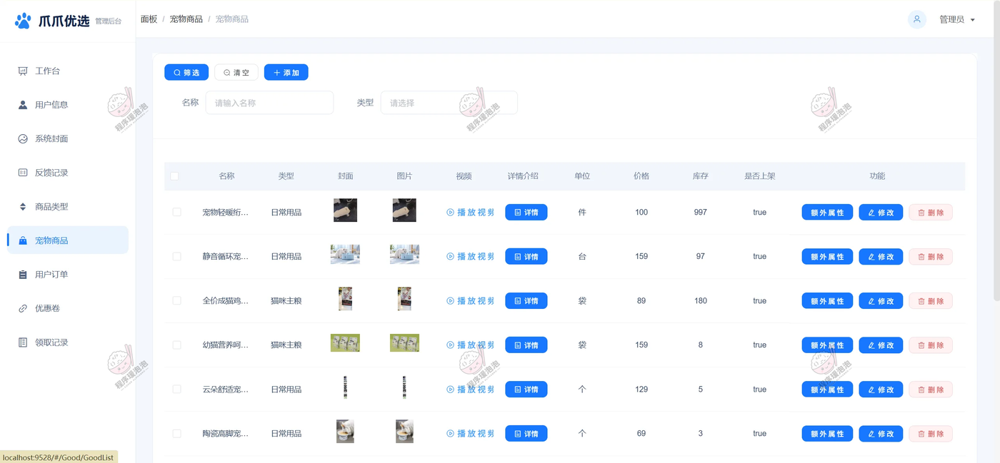

**宠物商品 · 资料维护**
列表里能看到名称、类型、封面、图片、视频、详情介绍、单位、价格、库存和是否上架，每行可进扩展属性改自定义字段，也能直接修改或删除。

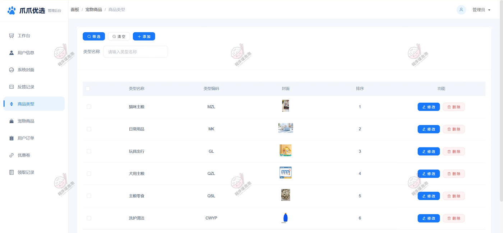

**商品类型 · 分类与排序**
类型名称配类型编码，可单独上传封面并设置排序，目前录了猫咪主粮、日常用品、玩具出行、犬用主粮、主粮零食、洗护清洁六类。

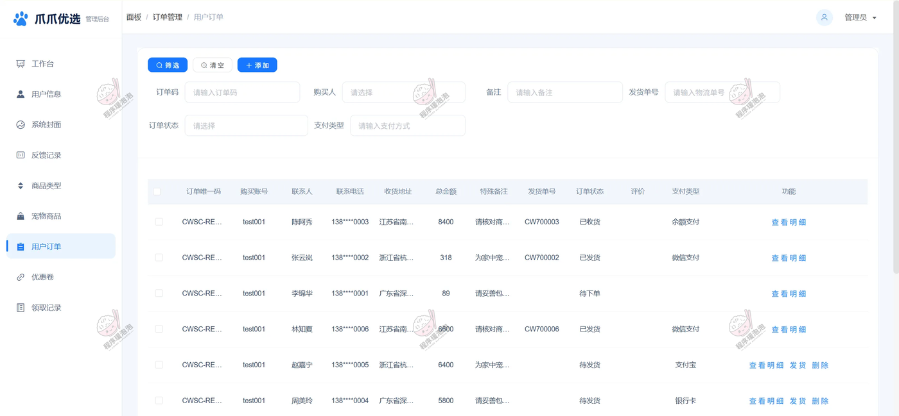

**用户订单 · 发货处理**
按订单码、购买人、订单状态、支付类型等条件查单，列表显示联系人、收货地址、总金额、特殊备注、发货单号和评价状态，待发货的订单可直接填单号发货。

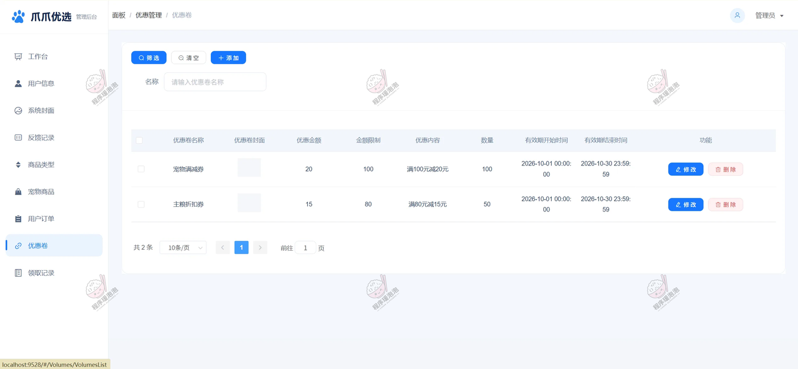

**优惠券 · 配置与门槛**
优惠券设名称、封面、优惠金额、金额限制、优惠内容、发放数量，以及有效期起止时间，例如满 100 元减 20 元、满 80 元减 15 元。

### 其余页面

后台还有用户信息、系统封面、反馈记录、领取记录几个模块，分别对应账号维护、首页轮播配置、用户反馈回复和优惠券领取明细，未在本文档单独截图。

---

文档展示 12 张截图，需要了解更多，请联系我。
